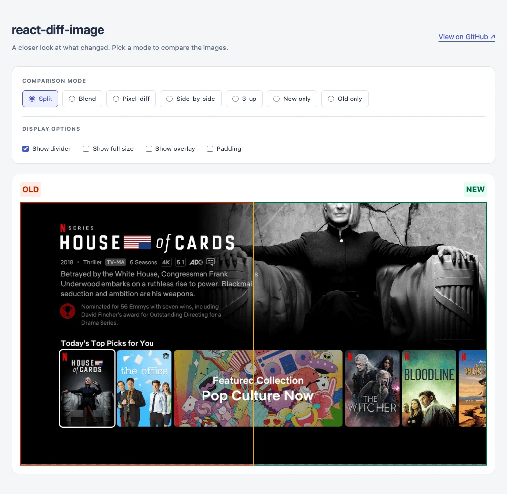
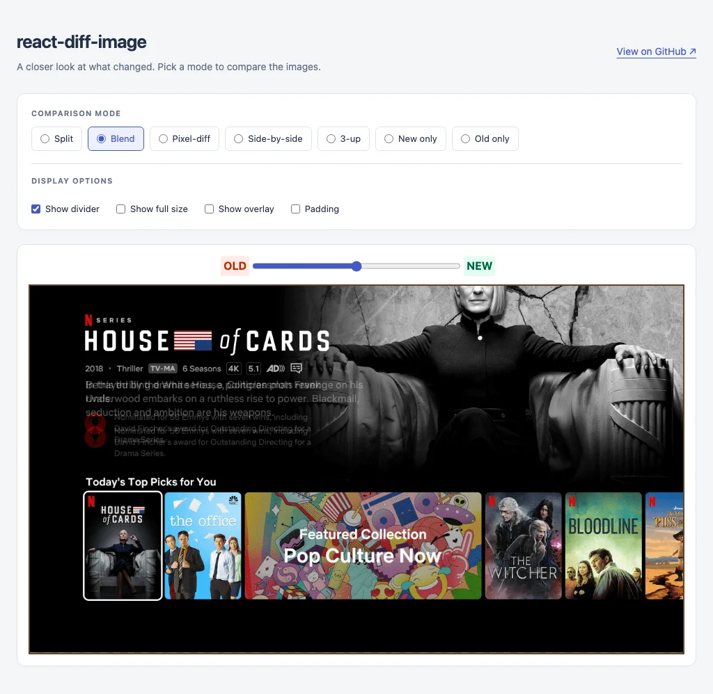
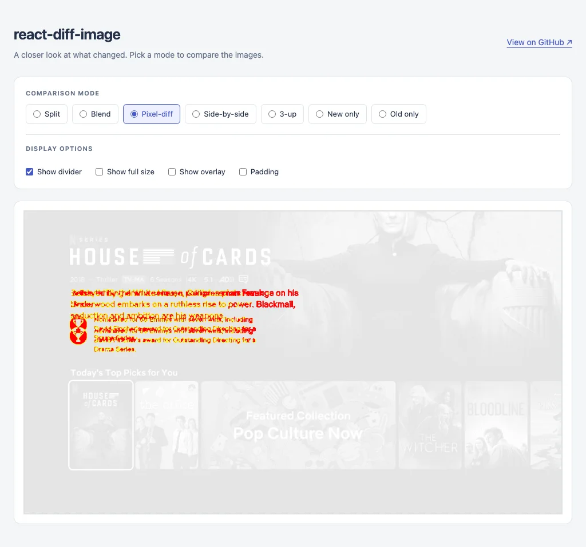
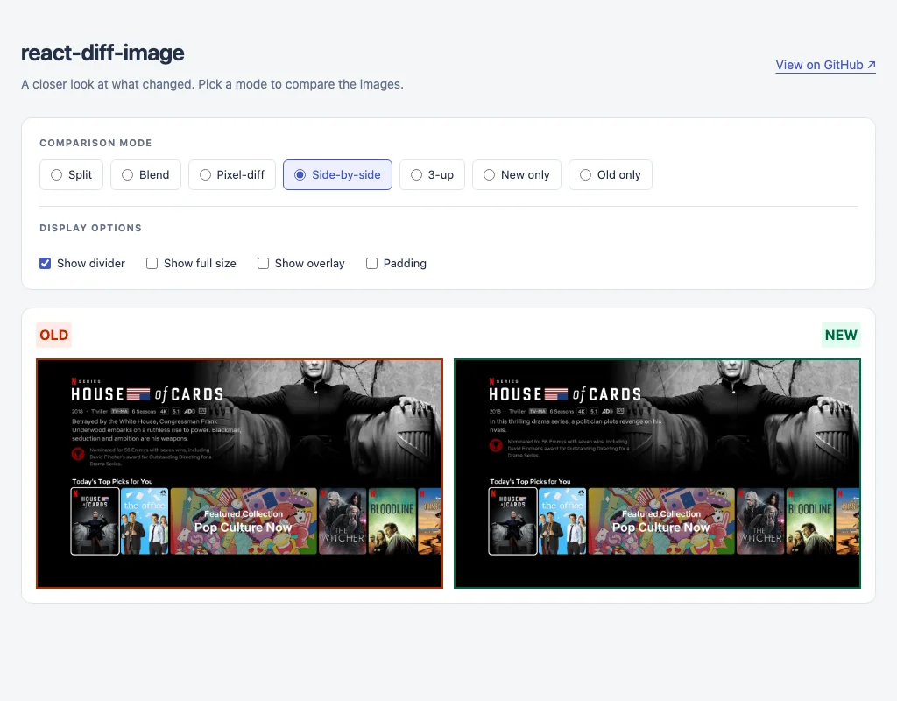
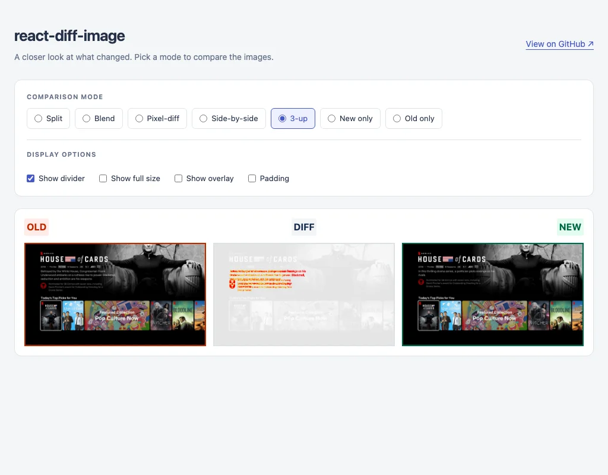
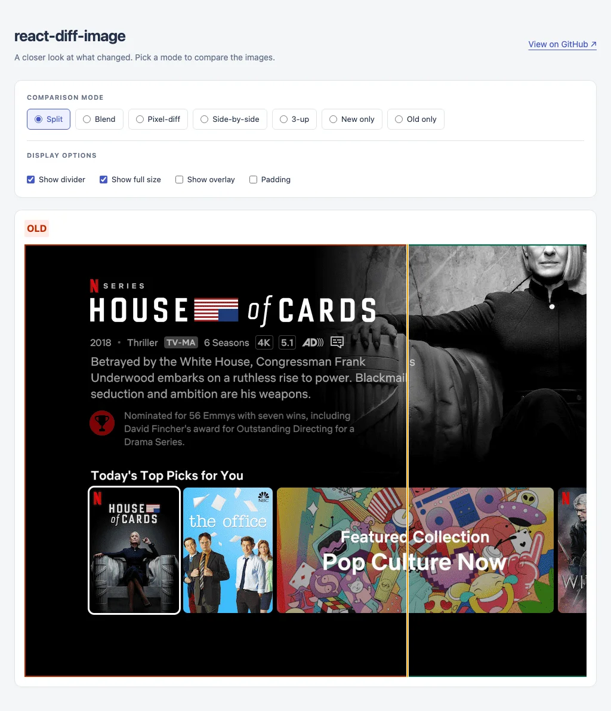

# react-diff-image

Zero-dependency React component providing different modes for diffing or comparing images. The image format is the same as that generated by `jest-image-snapshot`, a three part image with the order old-diff-new. All styles are inline for maximum portability.

## Install and use

```sh
npm install react-diff-image
```

Use React 16.14, 17, 18, or 19. Pass a single sprite containing the old image, diff, and new image in equal-width panels.
Cross-origin image servers must allow anonymous CORS requests so the component can load and analyze the sprite.

```tsx
import { ImageDiff } from "react-diff-image";

<ImageDiff url="/old-diff-new.png" mode="split" />;
```

The package includes ESM and CommonJS entry points, TypeScript declarations, and a `"use client"` boundary for React Server Components.
In split mode, move the pointer or drag on a touchscreen. Keyboard users can focus the comparison and use the arrow keys, Page Up, Page Down, Home, or End. Hold Shift with an arrow key to move by ten percent.
The blend slider supports native keyboard and touch input.

## Image comparison modes

### `split`

Drag a handle to view a split of old vs new



### `blend`

Using a native `input` slider, fade the new image over the old



### `pixel-diff`

Show the diff image directly



### `side-by-side`

Display both images side-by-side



### `3-up`

Display old, diff, and new images side-by-side



### `new-only`

Display only the new image


### `old-only`

Display only the old image


## Configuration

### `showOverlay`

Generate a magenta overlay to highlight small changes.


### `showFullSize`

By default the component will responsively fit the image into the container size. Set `showFullSize` to `true` to display the image at its full size.



### `showDivider`

Defaults to true. Shows an orange divider line between the old and new images in `split` mode. Set to `false` to hide.


### `hasPadding`

Defaults to false. Adds padding around the images with a standard checkerboard pattern. Makes it easier to see the edges of the images.


### `style`

Optional styles for the root wrapper `div`.

## Performance

- The overlay scans the full-resolution diff for changed pixels. It deduplicates highlight centers, fills dense interiors in horizontal runs, and encodes the result at half resolution. The first render can finish before the encode starts, and later toggles reuse the overlay for the loaded image.
- The image loader and visible panels use the same browser request mode so they can share the source image. The cache keeps up to eight recently used sprites within a 128 MiB estimated decoded-size budget.
- Split and blend update clipping and opacity directly during pointer and slider input, avoiding a React render for each movement.

## Changelog

### 2.1.1

**Documentation:** Republished with changelog.

### 2.1.0

**Added:** `oldLabel`, `newLabel`, and `diffLabel` on `ImageDiff` now control the visible tag text in every comparison mode that shows labels (`3-up`, `side-by-side`, `split`, `blend`, `old-only`, `new-only`).

### 2.0.0

**Breaking change:** the root container no longer sets default `alignSelf`, `flexGrow`, `maxWidth`, or `overflow`. Those values interacted badly with some layouts, and full-size scrolling is better decided by the host. If you depended on the old behavior—for example in a flex column—recreate it with the `style` prop, for example:

```tsx
<ImageDiff
    url={url}
    style={{
        alignSelf: "stretch",
        flexGrow: 1,
        maxWidth: "100%",
        overflow: showFullSize ? "auto" : "hidden",
    }}
/>
```

## Development

Use Node.js 24.15 or newer. CI checks Node.js 24 and 26 LTS, plus package compatibility with React 16.14, 17, 18, and 19.

```sh
npm ci
npm exec -- playwright install chromium
npm run check
```

`npm run check` builds the library, checks types, lints, checks formatting, and runs package and browser tests.
Package tests install the generated tarball into an isolated consumer and verify both module formats and their TypeScript declarations.
Browser tests cover comparison modes, labels, resizing, keyboard and touch controls, image URL changes, failed loads, and overlays.

`npm ci` installs the Git pre-push hook. Every push runs `npm run prepush`, which checks both Node.js versions
and every React compatibility version from CI in a temporary directory. The checks include the demo build and
`npm audit --audit-level=low`. The hook downloads the required Node.js versions and Chromium as needed.
Any failed check blocks the push. Run `npm run prepush` to check the full matrix manually.

CI uses the same `ci:check` and `ci:compatibility` commands. Keep the version matrices in
`scripts/prepush.mjs` and `.github/workflows/ci.yml` aligned when changing supported versions.
GitHub requires every CI matrix job to pass before a pull request can merge into `main`.

```sh
npm run build
npm run lint:fix
npm run format:fix
```

The toolchain uses tsdown for library and demo builds, TypeScript 7 for type checking, type-aware Oxlint with React Hooks and accessibility rules, and Oxfmt for formatting and import sorting.
Oxlint enables the correctness, suspicious, pedantic, performance, and style categories as errors, plus selected restriction rules.
The configuration explicitly includes Unicorn, Oxc, and Promise checks. Warnings and unused lint suppressions fail linting.
Type-aware rules reject unsafe assignments and assertions, unhandled promises, non-null assertions, and incomplete switches over unions.

The exceptions in `.oxlintrc.json` preserve named public exports, the automatic JSX runtime, JSX prop spreading, and React's `null` values.
Oxfmt owns import ordering. TypeScript owns return-path checking, and ES2020 compatibility excludes `String.replaceAll` suggestions.
Truthiness checks, one-line guards, bare `return`, numeric layout constants, ternaries, and callback-based image loading remain supported.
Arbitrary limits on identifier length, function size, dependency counts, and JSX depth are disabled.
File-specific overrides allow default exports in tool configurations, sequential browser interactions, Node imports and synchronous package checks, and console output in performance scripts.
Browser-evaluated performance helpers stay inside their serialized callbacks, and image-load failures explicitly resolve to `undefined`.

Declaration generation uses Oxc through TypeScript's `isolatedDeclarations` contract.
React remains a peer dependency, and the published package has no runtime dependencies.
Dependabot checks npm packages and GitHub Actions weekly.

## Releases

Every push runs CI. After all Node and React compatibility jobs pass on `main`, CI calculates the next version,
publishes to npm, pushes a version tag, and creates a GitHub release with generated notes.
Branch pushes, tags, and pull requests never publish. Docs and tooling changes do not trigger a release.

The squash-merged PR title declares the version change:

| PR title                                                                     | Bump  | Example from 2.1.1 |
| ---------------------------------------------------------------------------- | ----- | ------------------ |
| `fix: repair dragging`, `perf: reduce overlay cost`, `revert: undo a change` | Patch | 2.1.2              |
| `feat: add a mode`                                                           | Minor | 2.2.0              |
| `feat!: replace props`, `fix(api)!: change defaults`                         | Major | 3.0.0              |
| `docs:`, `test:`, `ci:`, `build:`, `chore:`, `refactor:`, `style:`           | None  | No release         |

Scopes are optional. Any accepted type with `!` triggers a major release and requires a nonempty `BREAKING CHANGE:`
footer in the PR description. Describe the incompatible change and how to migrate, for example:

```text
BREAKING CHANGE: oldLabel was removed. Replace it with labels.old in every ImageDiff call.
```

The footer appears in the GitHub release's breaking changes section. A breaking-change footer also requires `!` in
the title, keeping the declared bump consistent with the generated notes.
Changes since the last version tag are combined, and the largest bump wins.
A failed release remains pending for a later successful run; publishing jobs run one at a time.
The first automated release includes the unreleased commits since `v2.1.1`, including the overlay performance improvements.

The required `release-policy` check rejects invalid titles, CI-skip markers, manual version changes, and library or
published-metadata changes without a release-producing title. Source under `src/demo/` is exempt from the library rule.
Reviewers must check the meaning of the change: removing props, changing defaults incompatibly, or dropping a supported
React version requires `!`. CI cannot infer every breaking change from source.

Squash merging preserves the PR title and description. CI validates both, including rejecting CI-skip markers in
the description. The main branch rules require pull requests and passing checks, with no bypass actors.
Keep the validated title and description when merging so release notes retain the migration details.

Release-it reads the latest Git version tag rather than the checked-in package version. It updates `package.json`
and the lockfile only in the publishing workspace; CI never commits version changes to `main`.
GitHub releases contain the current changelog. The README changelog above records the earlier manual releases.

### Configure trusted publishing

In [npm package settings](https://www.npmjs.com/package/react-diff-image/access), add a GitHub Actions trusted publisher:

- Owner: `ianobermiller`
- Repository: `react-diff-image`
- Workflow filename: `ci.yml`
- Environment: `npm`
- Allow direct publishing, rather than stage-only publishing.

The GitHub `npm` environment permits deployments only from `main`. The publishing job uses OIDC and provenance;
it needs no `NPM_TOKEN`. Keep npm token publishing disabled in the package settings.
See [npm trusted publishing](https://docs.npmjs.com/trusted-publishers/) and
[release-it trusted publishing](https://github.com/release-it/release-it/blob/main/docs/npm.md#trusted-publishing-oidc).

To retry a failed release, rerun the failed CI job. If npm publishing succeeded but the tag push or GitHub release
failed, first recover the tag and GitHub release at that exact commit and published version. npm versions are immutable;
do not delete a published version or create a different tag to bypass the failure.

## Demo

Since `ImageDiff` does not include any configuration controls, the demo is a simple showcase of the modes and options.

```sh
npm run demo:watch
# another terminal
npm run demo:serve
# open http://127.0.0.1:3000
```

## Run the benchmark

Use Node.js 24.15 or newer. Install the root development dependencies and Chromium, then start the demo server.

```sh
npm ci
npm exec -- playwright install chromium
npm run demo:build
node perf/server.mjs
```

Run the benchmark in a second terminal.

```sh
node perf/measure.mjs http://127.0.0.1:8765 - current
```

The script reports first-overlay and repeat-overlay times and verifies that split and blend update the expected styles. Pass a directory in place of `-` to save screenshots. Set `CHROMIUM_EXECUTABLE_PATH` to use an existing Chromium binary. To compare builds, alternate runs with the same browser and image fixture.
