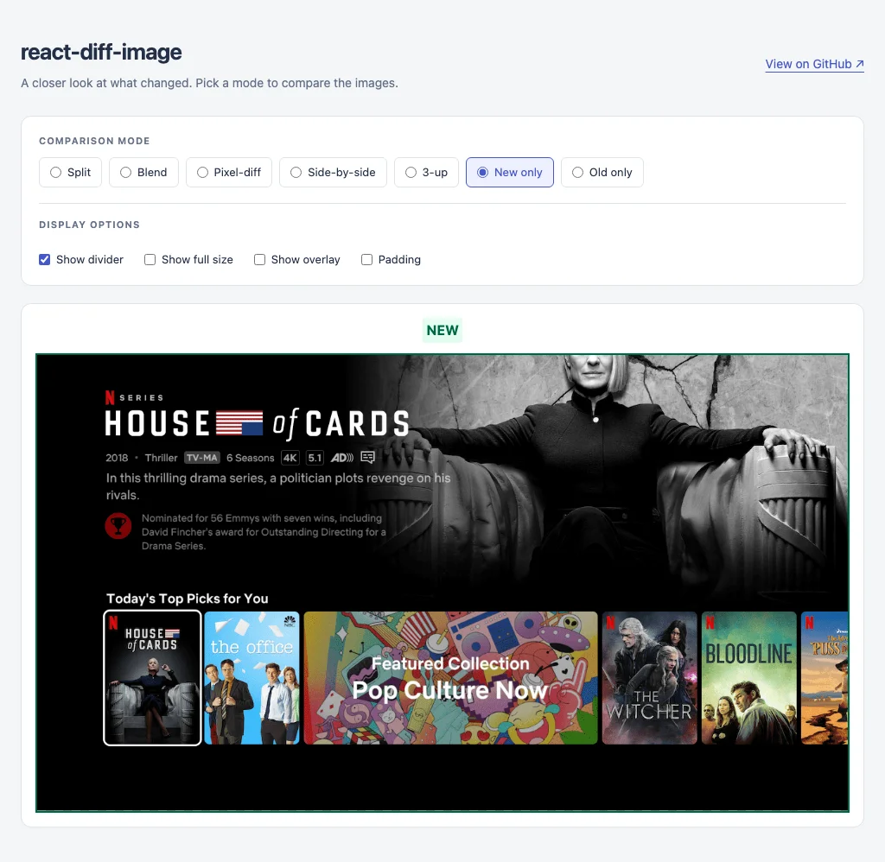
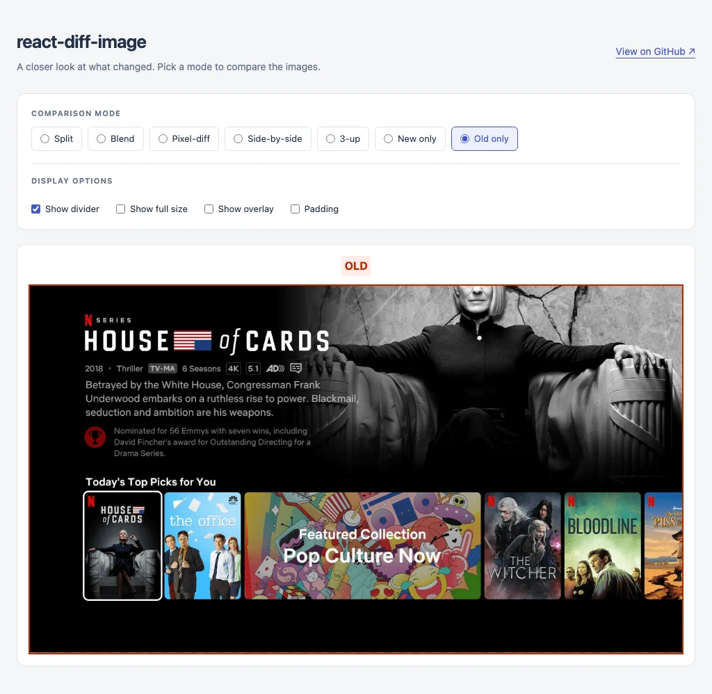
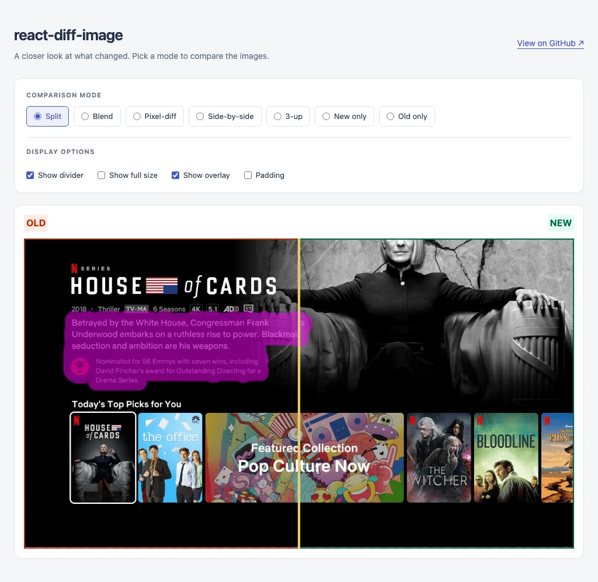
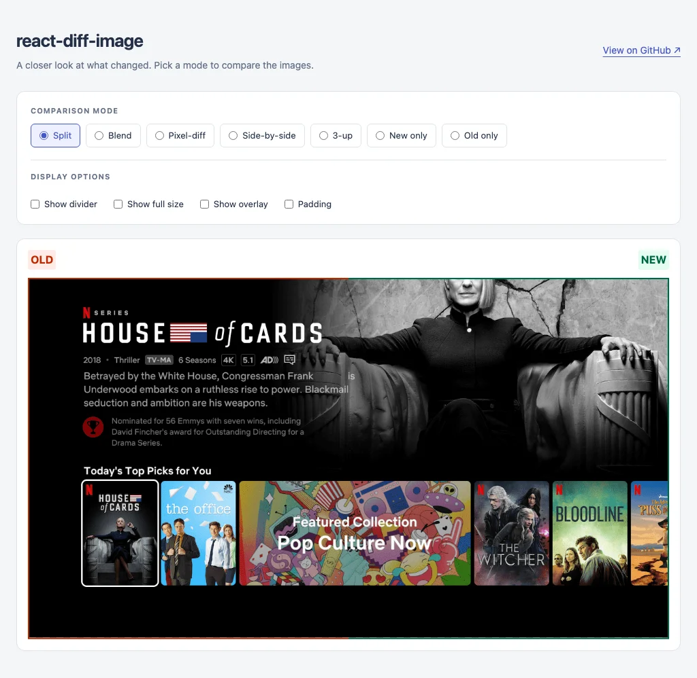
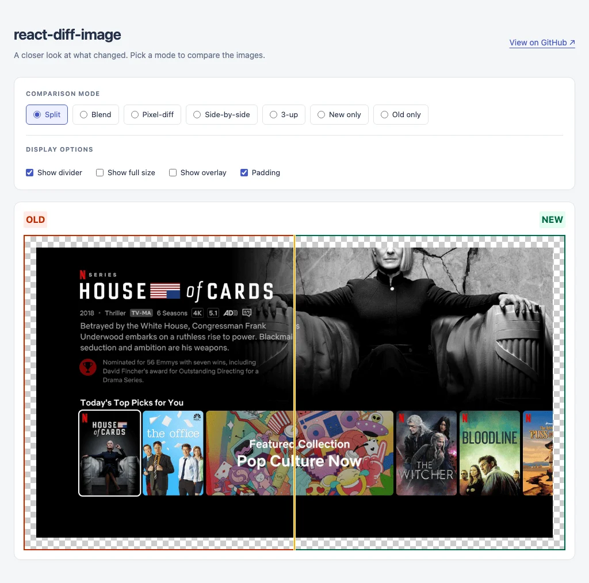

# react-image-diff

Zero-dependency React component providing different modes for diffing or comparing images. The image format is the same as that generated by `jest-image-snapshot`, a three part image with the order old-diff-new. All styles are inline for maximum portability.

## Image comparison modes

### `split`

Drag a handle to view a split of old vs new


### `blend`

Using a native `input` slider, fade the new image over the old


### `pixel-diff`

Show the diff image directly


### `side-by-side`

Display both images side-by-side


### `3-up`

Display old, diff, and new images side-by-side


### `new-only`

Display only the new image



### `old-only`

Display only the old image



## Configuration

### `showOverlay`

Generate a magenta overlay to highlight small changes.



### `showFullSize`

By default the component will responsively fit the image into the container size. Set `showFullSize` to `true` to display the image at its full size.


### `showDivider`

Defaults to true. Shows an orange divider line between the old and new images in `split` mode. Set to `false` to hide.



### `hasPadding`

Defaults to false. Adds padding around the images with a standard checkerboard pattern. Makes it easier to see the edges of the images.



### `style`

Optional styles for the root wrapper `div`.

## Performance

- The overlay scans the full-resolution diff for changed pixels. It deduplicates highlight centers, fills dense interiors in horizontal runs, and encodes the result at half resolution. The first render can finish before the encode starts, and later toggles reuse the overlay for the loaded image.
- The image loader and visible panels use the same browser request mode so they can share the source image. The cache keeps up to eight recently used sprites within a 128 MiB estimated decoded-size budget.
- Split and blend update clipping and opacity directly during pointer and slider input, avoiding a React render for each movement.

## Changelog

### 2.1.1

**Documentation:** Republished with changelog.

### 2.1.0

**Added:** `oldLabel`, `newLabel`, and `diffLabel` on `ImageDiff` now control the visible tag text in every comparison mode that shows labels (`3-up`, `side-by-side`, `split`, `blend`, `old-only`, `new-only`).

### 2.0.0

**Breaking change:** the root container no longer sets default `alignSelf`, `flexGrow`, `maxWidth`, or `overflow`. Those values interacted badly with some layouts, and full-size scrolling is better decided by the host. If you depended on the old behavior—for example in a flex column—recreate it with the `style` prop, for example:

```tsx
<ImageDiff
    url={url}
    style={{
        alignSelf: "stretch",
        flexGrow: 1,
        maxWidth: "100%",
        overflow: showFullSize ? "auto" : "hidden",
    }}
/>
```

## Building

```sh
npm run build
```

## Demo

Since `ImageDiff` does not include any configuration controls, the demo is a simple showcase of the modes and options.

```sh
npm run demo:watch
# another terminal
npm run demo:serve
# open http://localhost:3000
```

## Run the benchmark

Use Node.js 20 or newer. Install the root development dependencies and Chromium, then start the demo server.

```sh
npm ci
npm exec -- playwright-core install chromium
npm run demo:build -- --env.NODE_ENV production
node perf/server.mjs
```

Run the benchmark in a second terminal.

```sh
node perf/measure.mjs http://127.0.0.1:8765 - current
```

The script reports first-overlay and repeat-overlay times and verifies that split and blend update the expected styles. Pass a directory in place of `-` to save screenshots. Set `CHROMIUM_EXECUTABLE_PATH` to use an existing Chromium binary. To compare builds, alternate runs with the same browser and image fixture.
